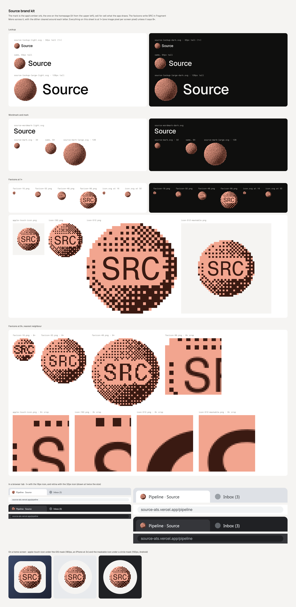

# Source brand kit

The logo is the orb and the word "Source". The orb is the app's own ember
orb, the one on the homepage (`<Orb palette="ember" />`): Orbkit's SHDR-14
as a still frame, a lit dome dithered to two tones (ember: ink `#3A1A12`,
paper `#F2A58F`) through an 8×8 Bayer matrix, lit from the upper left. It is
drawn cell for cell as `src/components/ui/orb.tsx` draws it, and the preview
script checks that. The word
is Geist Medium, kerned by the font, converted to outlines. No file here
needs a font installed.



## Files

Every PNG has a transparent background unless noted. `@2x` and `@4x` are
the same artwork at 2 and 4 times the pixels.

| File | What | 1× size |
|---|---|---|
| `source-lockup-light.svg` · `.png` · `@2x` · `@4x` | Orb and wordmark, ink text, for light backgrounds | 105 × 32 |
| `source-lockup-dark.svg` · `.png` · `@2x` · `@4x` | Orb and wordmark, light text, for dark backgrounds | 105 × 32 |
| `source-lockup-large-light.svg` / `-dark.svg` (+ PNGs) | The lockup with the finer 64-cell orb, for big uses | 210 × 64 |
| `source-wordmark-light.svg` / `-dark.svg` (+ PNGs) | "Source" alone | 64 × 16 |
| `source-mark.svg` (+ PNGs) | The orb, 32 cells across (what the app draws at 32px) | 32 × 32 |
| `source-mark-large.svg` (+ PNGs) | The orb, 64 cells across (what the app draws at 96px) | 64 × 64 |
| `favicon/` | The favicon set, below | |
| `preview.png` | Contact sheet of all of the above | |

The mark has no light and dark versions. The orb carries its own two colors
and is the same on light and dark, as it is in the app.

## Using it

- **Light or dark.** Use `-light` (ink `#0A0A0A` text) on the light canvas
  `#F5F4F2` or white. Use `-dark` (`#F5F4F2` text) on the dark canvas
  `#0F0F0E` or anything darker than mid-grey.
- **Clear space.** Keep half the orb's diameter clear on every side of the
  lockup and the mark. For the wordmark alone, keep the height of its
  capital S clear.
- **Minimum size.** The lockup at 32px tall, the mark at 32px, and the
  wordmark at 16px tall. For anything smaller, use the favicon.
- **Keep the dither on whole pixels.** The orb is a grid of square cells. It
  stays crisp at whole multiples of its size: 32, 64, 96, 128px tall for the
  standard files, and 64, 128, 192, 256px for `-large`. At in-between sizes
  the cells come out uneven. Above about 128px tall, use `-large`.
- **Don't** recolor the orb, smooth or blur the dither, redraw "Source" in
  another weight or font, or rearrange the mark and word.

## Favicons

The favicon writes `SRC` in Fragment Mono across the orb. The dither is cleared in a margin around each
letter, so the letters sit in a clean gap of the orb's light tone. The
letters are the orb's own ink, so the icon stays two tones. `SRC` is only
for icons. The logo is the lockup.

Each size is rendered on its own grid, never scaled down from a bigger
image, which would average the dither into mush:

| File | Size | How it's drawn |
|---|---|---|
| `favicon.ico` | 16, 32, 48 | The three PNGs below, unscaled |
| `favicon-16.png` | 16 | A 16-cell orb at 1px per cell. The letters are Fragment Mono's own hinted 1-bit rendering at a 5.5px size. The hinter keeps 6px capitals but narrows each letter, so SRC spans 14 of the 16 columns. The dither is cleared a cell and a half around the letters, which leaves a ring of it on every side, and SRC stays legible at 1×. |
| `favicon-32.png` | 32 | A 32-cell orb at 1px per cell, with 8px capitals (1-bit hinted) |
| `favicon-48.png` | 48 | A 48-cell orb at 1px per cell, with 11px capitals (1-bit hinted) |
| `favicon-96.png` | 96 | The 32-cell icon at 3px per cell, with smooth letters |
| `apple-touch-icon.png` | 180 | The 32-cell icon at 4px per cell, inset on the canvas color (iOS fills transparency with black and rounds the corners itself) |
| `icon-192.png`, `icon-512.png` | 192, 512 | The 32-cell icon at 6 and 16px per cell (PWA, `purpose: any`) |
| `icon-512-maskable.png` | 512 | At 10px per cell, 62% of the width, on the canvas color, inside the maskable safe zone |
| `icon.svg` | any | The 32px icon as cells. A media query swaps in the 16px version when it's drawn as an image at 24px or smaller. |

In the app they are wired with Next.js file conventions:
`src/app/favicon.ico` (the ICO above), `src/app/apple-icon.png`, and
`src/app/manifest.ts`, which points at the 192, 512 and maskable PNGs here.

The ICO is the only `rel="icon"`, on purpose. Given any other icon, Chrome
takes it over the ICO (Next declares the ICO as 48×48):

- an SVG it renders once, at 16px times the largest screen scale (32px on
  a Mac, even with the display forced to 1×), so the media query never gets
  a say;
- a 32px PNG it uses as is.

Either way it scales that 32px bitmap down for 1× tabs, which turns the
dither to mush. With the ICO alone, Chrome shows the native 16px and 32px
frames pixel for pixel. That was checked in Chrome through
`chrome://favicon2`. `icon.svg` is here for anywhere else you need a
scalable icon.

## Regenerating

Everything here comes from code in `scripts/brand/`:

```sh
python3 -m venv .venv-brand
.venv-brand/bin/pip install -r scripts/brand/requirements.txt
.venv-brand/bin/python scripts/brand/make-brand-assets.py   # all SVGs and PNGs, plus the src/app icons
node scripts/brand/make-preview.mjs                          # checks the orb against the app, writes preview.png
```

The lockup's proportions are constants at the top of
`make-brand-assets.py`. The orb is 2.2 times the cap height. The gap from
the orb to the S is 0.28 of the orb's diameter. The orb is centred at 0.46
of the cap height, a little below the capitals' middle, because "Source" is
mostly lowercase. Tracking is −0.02em.
